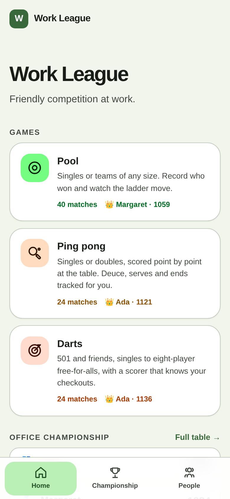
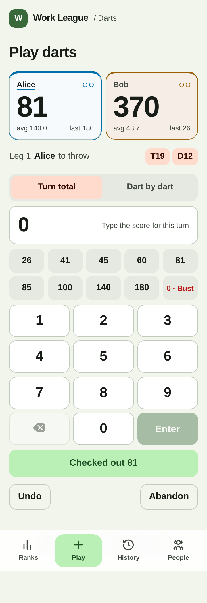
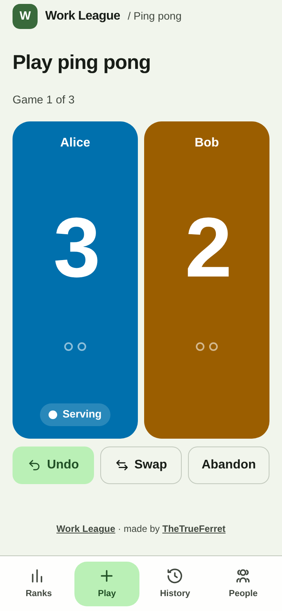
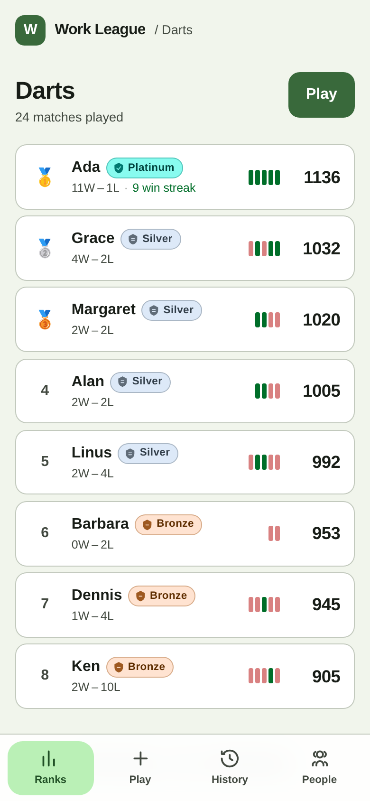
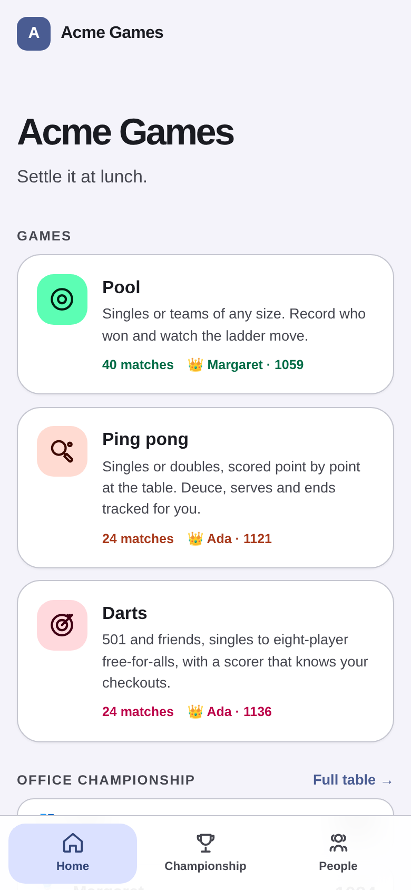

# Work League

A self-hosted league for friendly competition at work. Play **pool**, **ping pong** and **darts**
(or add your own game), keep a proper ELO ranking per game, and crown an **office champion**
across all of them.

Made by [TheTrueFerret](https://github.com/TheTrueFerret). Open source under the MIT licence:
clone it, host it for your office, make it yours.

<p>
  
  
  
  
  
</p>

## What you get

- **Game modules.** Each game is one folder with its own rules and its own match screen. Pool
  records teams of any size, ping pong has a point-by-point scorer, and darts has a full X01
  calculator with checkout hints. Admins switch games on and off without redeploying.
- **Ranks from Bronze to Diamond** in every game and in the championship, with progress to the
  next one on your profile.
- **ELO for every game.** One shared engine handles singles, teams and free-for-alls. Upsets pay,
  newcomers find their level fast, veterans settle down, and you see what you stand to win or lose
  before you play. Deleting an old result replays everything after it.
- **Office championship.** Everyone is on the table from day one. Your score is your average
  rating across every game, with games you haven't played counted at the starting rating.
- **Your brand.** Upload a logo and pick one colour (or take it from the logo), and the whole UI
  builds its light and dark palette from it, the way Android's Material You does.
- **Simple access.** One office passphrase keeps outsiders out, and a separate admin password
  protects settings and deletions. Optionally, anyone can view the rankings read-only.
- **Phone first.** Installable as an app, works with the screen on the table, keeps a live game
  safe on the device if the connection drops.
- **Hosts anywhere.** Cloudflare Workers with D1 (free tier friendly, nothing else to sign up
  for), or a single Docker container or Node process with a SQLite file.

## Quick start (local)

Needs Node 22.18 or newer. No database server required: development uses a SQLite file in
`./.data`, created and migrated on first use.

```sh
cp .env.example .env      # set ADMIN_PASSWORD
npm install
npm run seed              # optional: demo players and matches for every game
npm run dev
```

Open http://localhost:5173, sign in at `/admin` with your `ADMIN_PASSWORD`, then set your name,
logo, colour and office passphrase.

## Hosting

See [docs/self-hosting.md](docs/self-hosting.md) for the full guide. Summary:

| Where                 | Database                        | How                                                                                                       |
| --------------------- | ------------------------------- | --------------------------------------------------------------------------------------------------------- |
| Cloudflare Workers    | D1, created on the first deploy | `npx wrangler d1 create work-league`, `npx wrangler secret put ADMIN_PASSWORD`, `npm run deploy`          |
| Docker, one container | SQLite file in a volume         | `docker run -p 3000:3000 -v league:/data -e ADMIN_PASSWORD=… -e ORIGIN=http://localhost:3000 work-league` |
| Docker Compose        | SQLite file in a volume         | `ADMIN_PASSWORD=… docker compose up -d`                                                                   |
| Any Node host         | SQLite file (or Turso)          | `npm run build:node && npm run db:migrate && npm start`                                                   |

### Configuration

Only a few things come from the environment. Everything else is set in the app at `/admin`.

| Variable         | Required  | Purpose                                                                              |
| ---------------- | --------- | ------------------------------------------------------------------------------------ |
| `DATABASE_URL`   | Node only | `file:./path/league.db` for a SQLite file, or `libsql://…` for Turso. Workers use D1 |
| `ADMIN_PASSWORD` | for admin | Unlocks `/admin`. Without it, admin features stay off                                |
| `SESSION_SECRET` | no        | Signs cookies. If unset, a random one is generated and stored in the database        |
| `ORIGIN`         | Node only | The public URL, e.g. `https://league.example.com`, so form submissions are accepted  |

### Moving from PostgreSQL (Work League 0.1 or the Open Pottr pool ladder)

Work League used to store its data in PostgreSQL. It now uses SQLite: Cloudflare D1, or a local
file. One command copies a league across, from either the original pool ladder or Work League 0.1:

```sh
npm run import:postgres -- 'postgres://…'                         # writes work-league-import.sql
npx wrangler d1 execute DB --remote --file=work-league-import.sql  # on a new, migrated D1
```

Every person, match and rating comes across unchanged (nothing is recalculated, and a test proves a
full replay gives the same ratings), along with your settings. Upload your logo again at `/admin`.
For a local SQLite file instead of D1, add `--apply` with `DATABASE_URL=file:…` set.

## How ratings work

Every player starts at 1000 in each game. After a match, each player is compared with every
opposing side's average rating:

```text
expected = 1 / (1 + 10 ^ ((opponentAverage - rating) / 400))
change   = K × Σ(result - expected) / (sides - 1)
```

`result` is 1 for finishing ahead of that side, 0.5 for a tie, and 0 for finishing behind. `K` is 40 for
a player's first 10 games, 28 up to 30 games, and 20 after that. With two sides this is classic team
ELO; in a darts free-for-all a match still moves a player by at most one K.

### Ranks

Every game and the championship share one ladder, measured from the starting rating:

| Rank     | Rating (start 1000) |
| -------- | ------------------- |
| Diamond  | 1200 and up         |
| Platinum | 1125–1199           |
| Gold     | 1050–1124           |
| Silver   | 975–1049            |
| Bronze   | below 975           |

Everyone starts in Silver. Profiles show how many points you need for the next rank.

## Adding a game

A game is a folder in `src/lib/modules/<id>/` that exports a `GameModule`: its rules, rating
settings and a screen for recording a match. Register it in `src/lib/modules/registry.ts`, and it
gets rankings, history, profiles, championship points and theming automatically. See
[docs/writing-a-module.md](docs/writing-a-module.md).

## Development

```sh
npm run dev          # local development
npm run check        # TypeScript and Svelte diagnostics
npm run lint         # Prettier and ESLint
npm test             # unit and database tests (temporary SQLite files)
npm run test:e2e     # browser smoke tests (Playwright)
npm run build        # Cloudflare build; build:node for Node and Docker
npm run db:generate  # write a migration after changing a schema file
npm run db:migrate   # apply migrations to DATABASE_URL (local files also migrate on start)
npm run db:migrate:d1  # apply migrations to the Cloudflare D1 database
npm run seed         # demo data in an empty database
```

Stack: SvelteKit 2, Svelte 5, strict TypeScript, Drizzle ORM on SQLite (Cloudflare D1 or libSQL),
Valibot, and Material Color Utilities.

```text
src/lib/
├── core/            pure logic: ELO engine, standings, championship, formatting
├── modules/         game modules (pool, pingpong, darts) and the registry
├── components/      shared UI: side picker, icons, rating curve
├── live/            live-match state shared by the scorers
├── theme/           palette generation and logo processing
└── server/          database, repositories, auth, settings
src/routes/
├── [game=game]/     rankings, play and history for every game
├── players/         people and profiles
├── championship/    the office table
├── admin/           branding, games, access
└── unlock/          the office passphrase screen
```

## Credit

Work League is made by [TheTrueFerret](https://github.com/TheTrueFerret). The footer credit and
its link are part of the app, not a setting. The MIT licence lets you change anything, but if you
run a copy, please keep the credit. It's how other offices find the project.

## Licence

[MIT](LICENSE)
